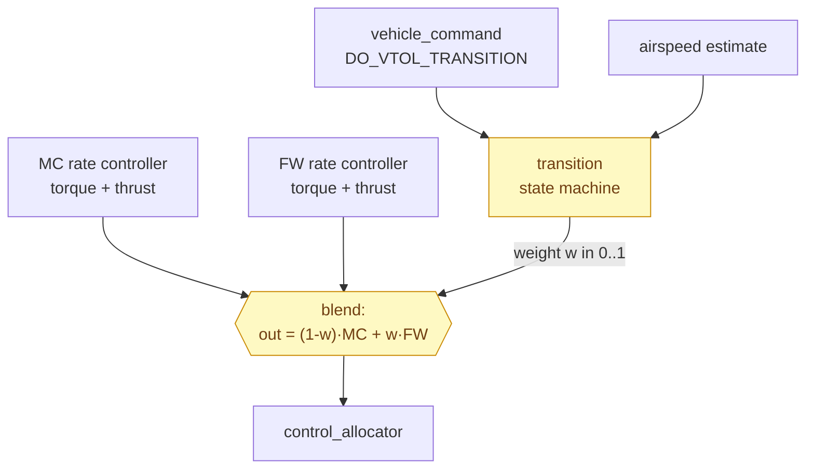
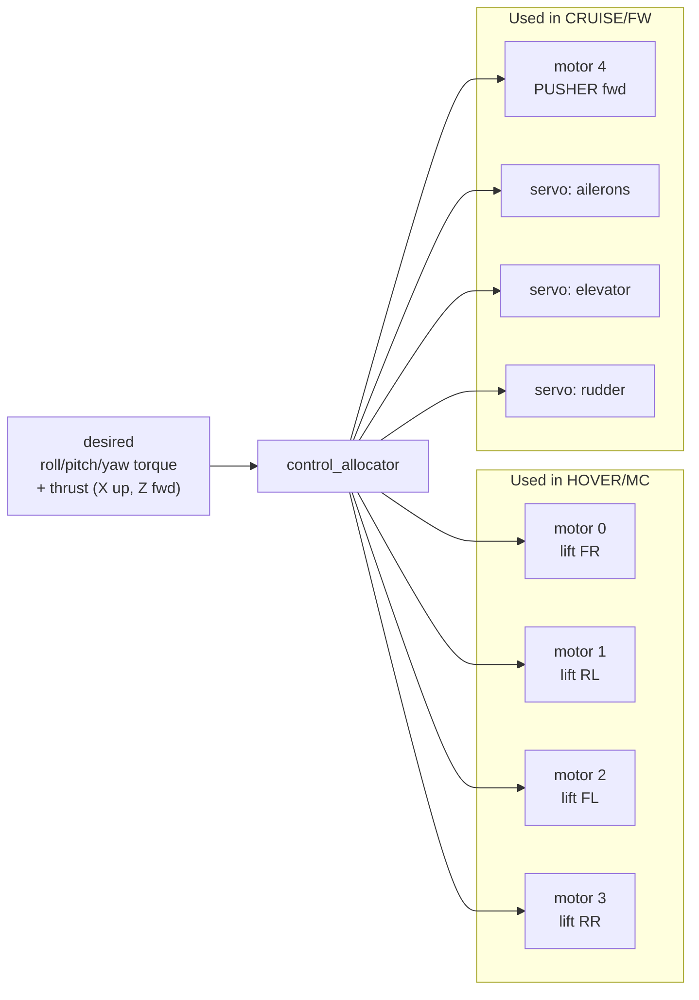

# How PX4 Controls the eVTOL — node by node

This explains **which PX4 module does what** to turn the script's "go here / become
an airplane" commands into spinning motors and deflecting control surfaces. It is
written for the **standard_vtol** airframe (`4004_gz_standard_vtol`,
`CA_AIRFRAME = 2`).

PX4 is a set of small programs ("modules") that talk over a shared message bus
called **uORB** (publish / subscribe). No module calls another directly — each one
subscribes to the topics it needs and publishes its result. The flight stack is a
chain of these.

---

## 1. The full control pipeline

```mermaid
flowchart LR
    subgraph SENSE[Estimation]
      direction TB
      sens[sensors / sim<br/>IMU, mag, baro,<br/>GPS, airspeed] -->|sensor_combined<br/>vehicle_gps_position| ekf[ekf2<br/>state estimator]
    end

    ekf -->|vehicle_local_position<br/>vehicle_attitude| nav

    subgraph DECIDE[What to do]
      direction TB
      mavlink[mavlink<br/>receives script msgs] -->|offboard_control_mode<br/>trajectory_setpoint| nav[flight_mode_manager /<br/>navigator]
      mavlink -->|vehicle_command| cmd[commander<br/>arming + mode logic]
    end

    nav -->|trajectory_setpoint| pos

    subgraph CONTROL[Cascaded control]
      direction TB
      pos[position controller<br/>MC and FW] -->|vehicle_attitude_setpoint| att[attitude controller<br/>MC and FW]
      att -->|vehicle_rates_setpoint| rate[rate controller<br/>MC and FW]
    end

    rate -->|vehicle_torque_setpoint<br/>vehicle_thrust_setpoint| vtol

    vtol[vtol_att_control<br/>blends MC and FW] -->|"torque + thrust<br/>(blended by phase)"| alloc

    alloc[control_allocator<br/>CA_AIRFRAME=2] -->|actuator_motors<br/>actuator_servos| out[outputs / sim bridge]
    out -->|motor + servo cmds| gz[Gazebo standard_vtol]
    gz -->|simulated sensors| sens

    cmd -. arming / vtol cmd .-> vtol
    cmd -. nav_state .-> nav

    classDef est fill:#dcfce7,stroke:#16a34a,color:#14532d;
    classDef dec fill:#e0e7ff,stroke:#4f46e5,color:#312e81;
    classDef ctl fill:#fee2e2,stroke:#dc2626,color:#7f1d1d;
    classDef vt fill:#fef9c3,stroke:#ca8a04,color:#713f12;
    class sens,ekf est;
    class mavlink,nav,cmd dec;
    class pos,att,rate ctl;
    class vtol,alloc,out vt;
```

**The loop:** sensors → `ekf2` estimates where/how the craft is → `mavlink` feeds in
the script's setpoints → `commander` decides arming/mode → the **cascaded controller**
(position → attitude → rate) computes the torque + thrust needed →
**`vtol_att_control`** decides *how to deliver* that torque/thrust given the current
VTOL phase → **`control_allocator`** maps it onto the 5 motors + 3 control surfaces →
the sim moves the aircraft → new sensor readings → repeat. Hundreds of times a second.

---

## 2. What each node contributes

| Module | Subscribes to (input) | Publishes (output) | Its job for the eVTOL |
|---|---|---|---|
| **sensors / sim** | Gazebo physics | `sensor_combined`, `vehicle_gps_position`, `airspeed` | Provides IMU/mag/baro/GPS **and airspeed** (airspeed is what FW flight and the forward transition depend on). |
| **ekf2** | sensor + GPS topics | `vehicle_local_position`, `vehicle_attitude`, `vehicle_global_position` | Fuses everything into one consistent estimate of position, velocity, attitude, wind. Everything downstream trusts this. |
| **mavlink** | UDP from the script | `offboard_control_mode`, `trajectory_setpoint`, `vehicle_command` | Translates the script's `SET_POSITION_TARGET` into a setpoint and its `DO_VTOL_TRANSITION` / arm into commands. |
| **commander** | `vehicle_command`, health checks | `vehicle_status`, `actuator_armed` | Arming, mode switching, failsafes. Enforces the rule that you cannot transition to FW during takeoff/land/RTL. |
| **flight_mode_manager / navigator** | setpoints, `vehicle_status` | `trajectory_setpoint` | Picks the active setpoint source for the current mode (here: OFFBOARD → the script; AUTO.LAND → PX4's own descent). |
| **mc / fw position controller** | `trajectory_setpoint`, local position | `vehicle_attitude_setpoint` | Turns "be at N=…, alt=50" into a desired attitude + thrust. **MC** version hovers/translates; **FW** version coordinates turns + holds airspeed. |
| **mc / fw attitude controller** | `vehicle_attitude_setpoint` | `vehicle_rates_setpoint` | Turns desired attitude into desired body rotation rates. |
| **mc / fw rate controller** | `vehicle_rates_setpoint`, gyro | `vehicle_torque_setpoint`, `vehicle_thrust_setpoint` | The fast inner loop: PID on roll/pitch/yaw rates → torque + thrust demand. |
| **vtol_att_control** | both controllers' torque/thrust, `vehicle_command` | blended `vehicle_torque_setpoint`, `vehicle_thrust_setpoint` | **The heart of the VTOL.** Runs the transition state machine and *blends* MC and FW outputs so the aircraft stays controllable while morphing between the two. |
| **control_allocator** | blended torque + thrust | `actuator_motors`, `actuator_servos` | Solves "what motor speeds + surface deflections produce this torque/thrust" for *this specific airframe geometry*. |
| **simulator_mavlink / gz_bridge** | `actuator_motors`, `actuator_servos` | motor/servo commands to Gazebo | Pushes outputs into the sim and returns simulated sensor data (lockstep). |

---

## 3. The piece that makes it a VTOL: `vtol_att_control`

A plain multicopter has *one* controller. A VTOL has **two** (MC and FW), and the
job of `vtol_att_control` is to decide, moment to moment, **how much of each** drives
the actuators:

- **MC phase** (`w = 0`): only the multicopter controller drives the 4 lift motors.
- **Forward transition** (`w: 0→1`): the pusher ramps up; as measured airspeed
  approaches `VT_ARSP_TRANS`, weight shifts to the FW controller and the lift motors
  throttle down.
- **FW phase** (`w = 1`): only the fixed-wing controller drives the pusher + surfaces;
  lift motors are off.
- **Back transition** (`w: 1→0`): lift motors spin back up, pusher eases, the craft
  bleeds off speed and settles into a hover.

This is why the script never has to "fly the transition" — it just sets the target
state and streams a position setpoint; `vtol_att_control` keeps the aircraft stable
through the morph.

---

## 4. Control allocation for *this* airframe (5 rotors + 3 surfaces)

From `4004_gz_standard_vtol`: `CA_ROTOR_COUNT = 5`. Rotors 0–3 are the lift quad,
rotor 4 (`CA_ROTOR4_AX = 1`) is the **pusher** pointing forward. Plus aileron /
elevator / rudder servos.

The allocator knows each rotor's position (`CA_ROTOR*_PX/PY`) and spin direction
(`CA_ROTOR*_KM`), so it can produce a pure roll/pitch/yaw torque in hover by speeding
up some lift motors and slowing others — and in cruise it leaves lift motors off and
uses the pusher + surfaces instead. **Same allocator, different effectors per phase**
— that is the whole trick of a standard VTOL.

---

## 5. Which controller is active in each mission step

| Step | Mode (nav_state) | VTOL phase | Effectors doing the work |
|---|---|---|---|
| ① climb to 50 m | OFFBOARD | MC | 4 lift motors (hover-climb) |
| ② transition → FW | OFFBOARD | TRANS_FW | lift motors **+** pusher ramps up |
| ③ cruise 100 m N | OFFBOARD | FW | pusher + ailerons/elevator/rudder |
| ④ transition → MC | OFFBOARD | TRANS_MC | lift motors spin up, pusher eases |
| ⑤ land | AUTO.LAND | MC | 4 lift motors (vertical descent) |

Read this table next to diagram **A** in `EVTOL_flow_diagram.md` — the colours match
(blue = MC, yellow = FW).
