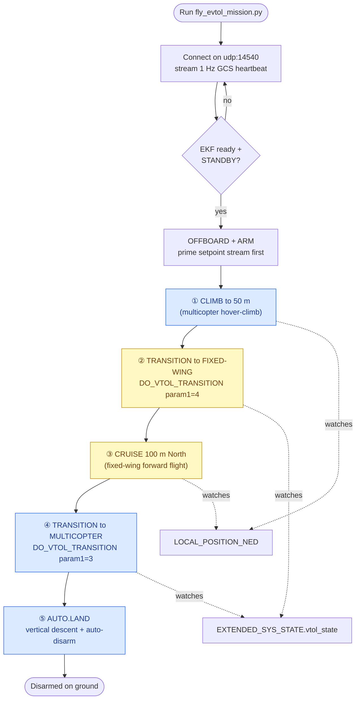
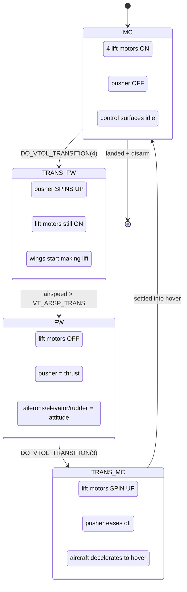

# eVTOL Flight — Flow Diagrams (follow along)

This file is the **map of the mission**: what the script commands, what PX4 does
in response, and how a VTOL switches between "quadcopter" and "airplane". Read it
top to bottom alongside `fly_evtol_mission.py`.

The aircraft is a PX4 **standard_vtol**: a quadrotor (4 lift motors) fused with an
airplane (1 pusher motor + ailerons / elevator / rudder).

---

## A. Mission flow — the 5 steps



Blue = flying as a **multicopter**, yellow = flying as a **fixed-wing**. The two
yellow steps are the only ones where the wings carry the aircraft.

---

## B. The VTOL state machine (what the airframe is doing)

`vtol_att_control` is the PX4 module that owns these states. The script only sends
"go to FW" / "go to MC"; PX4 runs the blended transition in between and reports the
live state in `EXTENDED_SYS_STATE.vtol_state`.



Key parameters (PX4 `VT_*`): `VT_ARSP_TRANS` (airspeed that completes the forward
transition), `VT_F_TRANS_DUR` (forward blend time), `VT_B_TRANS_DUR` (back-transition
time). The script does **not** set these — it just waits for `vtol_state` to flip.

---

## C. Script ↔ PX4 over the whole mission (sequence)

```mermaid
sequenceDiagram
    autonumber
    participant S as fly_evtol_mission.py
    participant M as MAVLink (udp 14540)
    participant C as PX4 commander
    participant V as vtol_att_control
    participant N as nav / position controllers

    loop every second, ALWAYS
        S->>C: HEARTBEAT (type=GCS)
    end

    S->>M: SET_MESSAGE_INTERVAL(LOCAL_POSITION_NED, EXTENDED_SYS_STATE)
    C-->>S: HEARTBEAT system_status=STANDBY
    loop 20 Hz, ALWAYS (keeps OFFBOARD alive)
        S->>N: SET_POSITION_TARGET_LOCAL_NED
    end

    S->>C: DO_SET_MODE(OFFBOARD) + ARM
    C-->>S: COMMAND_ACK ACCEPTED, HEARTBEAT armed
    Note over S,N: ① climb to 50 m (MC) — setpoint z = -50

    S->>V: DO_VTOL_TRANSITION(param1=4 FW)
    V-->>S: vtol_state ->FW... then FW
    Note over S,N: ② now fixed-wing; ③ stream North target, fly 100 m

    S->>V: DO_VTOL_TRANSITION(param1=3 MC)
    V-->>S: vtol_state ->MC... then MC
    Note over S,N: ④ hover hold at current spot

    S->>C: DO_SET_MODE(AUTO.LAND)
    C-->>S: STATUSTEXT "Landing detected" / "Disarmed by landing"
    Note over S,C: ⑤ touchdown + auto-disarm = mission complete
```

The two things that make this work and bit us before:
1. **The 1 Hz GCS heartbeat never stops** — without it PX4's "connection to GCS"
   arming check fails and the vehicle sits in `UNINIT`, refusing to arm.
2. **The 20 Hz setpoint stream never stops** — if it stalls > 0.5 s, PX4 drops
   OFFBOARD and triggers a failsafe.

See `EVTOL_architecture.md` for how each PX4 module turns these messages into motor
and control-surface commands.
