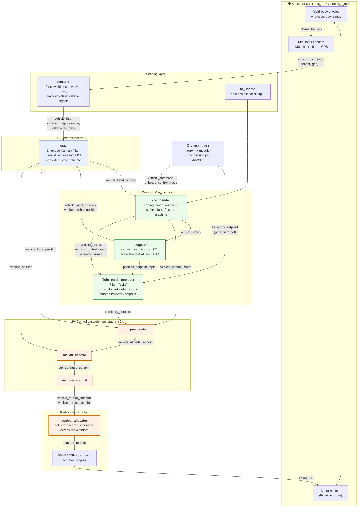
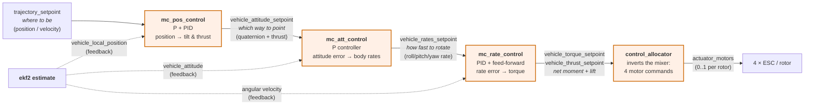
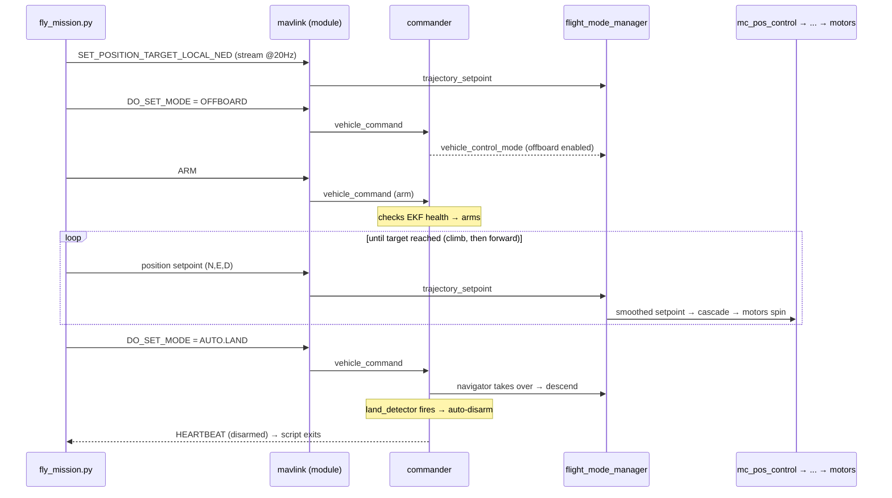

# PX4 Data-Flow Diagram — How the Drone Is Actually Controlled

This file is the **map you can follow**. It shows every major node (PX4 module),
what message (uORB topic) flows between them, and — below the diagrams — what each
node *does* and *why it matters*. Render the Mermaid blocks in VS Code (Markdown
Preview), GitHub, or https://mermaid.live.

> **Reading the arrows:** each arrow is a uORB topic — a named, strongly-typed
> message channel. A module *publishes* to a topic; any number of modules
> *subscribe*. Nobody calls anybody directly; they just swap messages on the bus.
> This is the single most important idea in PX4.

---

## 1. The whole loop, end to end

---

## 2. Zoom-in: the cascaded controller (the heart of flight)

Each stage takes a *higher-level* goal and produces a *lower-level* goal for the
next stage. Outer loops run slower and think in metres; inner loops run fast and
think in motor torque. This is **cascaded control**.

**Loop rates (typical, multicopter):**

| Stage | Module | Rate | Thinks in | Output |
|-------|--------|------|-----------|--------|
| Position | `mc_pos_control` | ~50 Hz | metres, m/s | tilt + collective thrust |
| Attitude | `mc_att_control` | ~250 Hz | quaternion error | desired body rates |
| Rate | `mc_rate_control` | ~1 kHz (sim: sensor rate) | rad/s | torque + thrust |
| Allocation | `control_allocator` | with rate loop | per-motor 0..1 | `actuator_motors` |

The rule of thumb: **outer loops are slow and forgiving, inner loops are fast and
stiff.** If the inner rate loop is unstable, nothing above it can save the drone.

---

## 3. What each node does and how it *contributes to control*

| Node (module) | Subscribes to (in) | Publishes (out) | Its job / why it matters |
|---------------|--------------------|------------------|--------------------------|
| **sensors** | raw driver topics | `vehicle_imu`, `vehicle_magnetometer`, `vehicle_air_data` | Picks healthy sensor instances, applies calibration/rotation, hands clean signals up. Garbage in here = crash. |
| **ekf2** | `vehicle_imu`, `sensor_gps`, mag, baro | `vehicle_attitude`, `vehicle_local_position`, `vehicle_global_position` | The drone's sense of *where am I and which way am I pointing*. Every controller below trusts this single estimate. |
| **commander** | `vehicle_command`, RC, EKF health | `vehicle_status`, `vehicle_control_mode`, `actuator_armed` | The referee: decides if you may arm, which flight mode is active, and triggers failsafes (e.g. drop to LAND on GPS loss). |
| **navigator** | `vehicle_global_position`, mission storage | `position_setpoint_triplet` | The autonomous planner: missions, RTL, and the AUTO.TAKEOFF / **AUTO.LAND** your script hands off to. |
| **flight_mode_manager** | `trajectory_setpoint` (offboard), `position_setpoint_triplet`, RC | `trajectory_setpoint` (smoothed), `vehicle_local_position_setpoint` | Runs "Flight Tasks". Converts *intent* (a stick, a waypoint, an offboard target) into a **smooth, feasible** trajectory the position loop can track. |
| **mc_pos_control** | `trajectory_setpoint`, `vehicle_local_position` | `vehicle_attitude_setpoint` | Outer loop. "I'm 50 m below target → tilt this much and push this much thrust." Position/velocity error → desired tilt + thrust. |
| **mc_att_control** | `vehicle_attitude_setpoint`, `vehicle_attitude` | `vehicle_rates_setpoint` | Middle loop. Attitude error (quaternion) → how fast to rotate to fix it. |
| **mc_rate_control** | `vehicle_rates_setpoint`, gyro | `vehicle_torque_setpoint`, `vehicle_thrust_setpoint` | Inner loop, fastest. Body-rate error → required torque (PID + feed-forward). The stabilising core. |
| **control_allocator** | `vehicle_torque_setpoint`, `vehicle_thrust_setpoint` | `actuator_motors`, `actuator_servos` | Solves "what motor commands produce this net torque + thrust?" for the specific airframe geometry. |
| **land_detector** | local position, thrust, actuator state | `vehicle_land_detected` | Tells commander/navigator when ground contact happened, so AUTO.LAND can auto-disarm. |
| **mavlink** | UDP from GCS / offboard | bridges uORB ↔ MAVLink | The radio/USB/UDP bridge. This is the module **`fly_mission.py` talks to** to inject setpoints and read telemetry. |

---

## 4. How your `fly_mission.py` rides this pipeline

The key insight: **your script never touches motors.** It only injects a
`trajectory_setpoint` and flips a mode. Everything from "go to N=10, D=-50" down
to "spin motor 3 at 62%" is PX4's cascade doing its job — exactly the same code
path a real pilot's autonomous flight would use.
